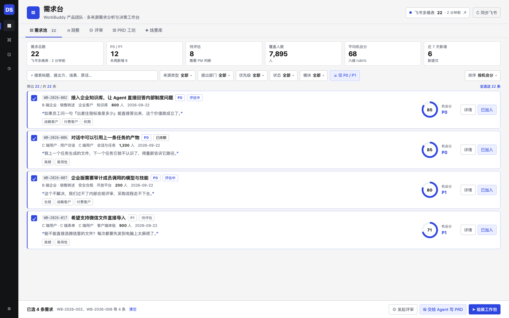
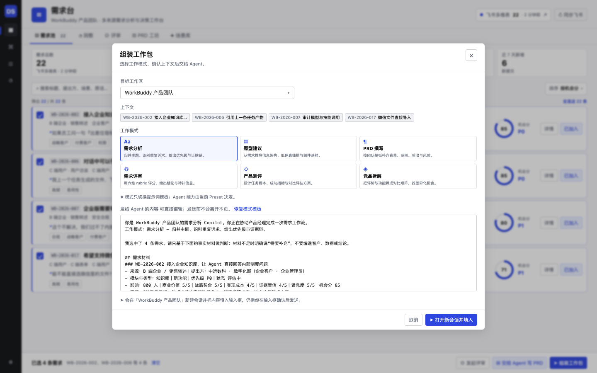
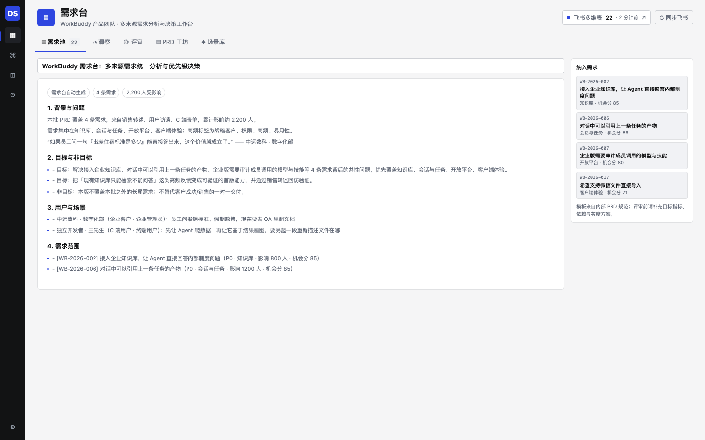

# 需求台 · WorkBuddy 产品团队 Demo

一个跑在 **DeepSeek Harness（DSH）** 里的产品经理工作台：

- 从 **飞书多维表**读取多渠道需求（客服/销售/应用市场/C 端表单/内部同事）；
- 在页面里做筛选、比较、六维评审、机会矩阵、PRD 初稿；
- 勾选需求后组装「工作包」，选择工作模式，**填入新会话输入框**交给 Agent；
- 在详情抽屉里把优先级、状态、PM 结论**真实写回飞书**。

这不是一个静态 HTML 页面，而是一个 DSH 插件页：左侧边栏入口 + `main` slot 页面 + Host 数据桥。

---

## 1. 快速打开

1. 打开 DSH（当前会话所在的桌面应用）。
2. 左侧边栏找到 **需求台** 图标（在「插件」和「录音套件」之间，order 26）。
3. 点击进入。页面会加载内置快照；点右上角「同步飞书」读取最新 Base 数据。

> 本机 demo 已安装到 `desktop` profile：`@local/requirements-desk`，`application: applied`。其他环境按第 5 节安装；页面未出现时刷新 DSH 页面或重启应用。

---

## 2. 界面示意

以下图片由代码渲染，用于展示信息架构与交互，不是 GUI 截图。







## 3. 页面能力

| 模块 | 能力 |
|---|---|
| 需求池 | 搜索、来源类型/部门/优先级/状态/模块筛选、P0/P1 快捷筛选、按机会分/时间/影响排序、多选 |
| 洞察 | 来源结构、部门声音、机会矩阵（成本 × 影响 × 商业价值）、模块聚类、决策信号 |
| 评审 | 六维 rubric（价值/战略/影响/置信/紧急/成本）、机会分、建议优先级、评审纪要复制 |
| PRD 工坊 | 按团队模板生成背景/目标/用户/范围/方案/验收/风险；复制/下载/交给 Agent |
| 场景库 | 6 个 Playbook：需求归并、评审、PRD、原型、测评、竞品；数据源连接状态 |
| 详情抽屉 | 原话、场景/痛点、评分依据、PM 决策（优先级/状态/结论）、保存到飞书 |
| 工作包 | 模式选择、目标工作区选择、上下文预览、prompt 编辑、`startSession` 填入新会话输入框 |

### 机会分算法

```js
impact = min(5, log10(people + 1) / log10(3000) * 5)
score = round(100 * (
  value*0.22 + fit*0.20 + confidence*0.12 +
  impact*0.16 + urgency*0.14 + (6-cost)*0.16
) / 5)
```

建议优先级：≥82 P0，≥68 P1，≥52 P2，否则 P3。算法只做辅助，PM 可在详情里覆盖并写回。

---

## 4. 飞书数据源

仓库自带 22 条虚构需求快照，不包含任何人的飞书 Base Token、App ID 或 App Secret。

连接自己的 Base：

| 项 | 值 |
|---|---|
| Base | 你自己的多维表 |
| 链接 | `https://<your-domain>.feishu.cn/base/<base_token>?table=<table_id>` |
| Base Token | 从 Base URL 的 `/base/` 后面取 |
| Table ID | 从 `?table=` 后面取，`tbl` 开头 |
| 身份 | `lark-cli --as user` |

把 `baseToken`、`tableId`、`baseUrl` 填进 `plugin/cordis.patch.yml`，或用环境变量/自己的 Host 配置覆盖。完整步骤见 [接入自己的飞书](docs/接入自己的飞书.md) 和 [飞书数据源](docs/飞书数据源.md)。

> 本插件不使用 App Secret。`lark-cli` 用户身份已经能读写 Base；Secret 不应进前端、仓库或截图。

---

## 5. 安装 / 重装

```bash
# 方式一：Plugin Manager（推荐）
# 在 DSH Plugins > Add plugin 选择本仓库的 plugin/ 目录

# 方式二：如果可用 plugin_manager 工具
# action: install_bundle, target: <本仓库>/plugin
```

`plugin/cordis.patch.yml` 里的 `cliPath` 默认留空，按 PATH 查找 `lark-cli`。如果同步失败，把它改成 `which lark-cli` 的绝对路径，或设置 `LARK_CLI` 环境变量。

安装后检查：

```bash
node --check plugin/client.js
node --check plugin/server.mjs
curl -s "${DSH_WEB_URL:-http://127.0.0.1:3000}/api/requirements-desk/state" | head -c 400
```

---

## 6. 文件结构

```
需求台-demo/
├── README.md
├── docs/
│   ├── 迁移能力清单.md        # WorkBuddy 能力 → DSH 映射
│   ├── 产品经理工作台场景.md   # 6 个可插件化场景 + 架构
│   ├── 飞书数据源.md          # Base 结构、命令、数据链路
│   ├── 接入自己的飞书.md      # 从零创建/连接自己的 Base
│   ├── fields.example.json    # 25 个字段的建表示例
│   └── screenshots/           # 代码渲染的界面示意
└── plugin/
    ├── package.json           # DSH bundle 元数据
    ├── cordis.patch.yml       # 插入 requirements-desk 行 + Base 配置
    ├── index.js               # Host 入口
    ├── server.mjs             # 数据桥（state/sync/update）
    ├── client.js              # 页面（React，无构建）
    ├── icon.svg               # 原创图标
    ├── locale/{zh,en}.json    # 插件元数据
    ├── docs/DETAIL.md         # 插件详情页
    └── data/
        └── requirements.snapshot.json  # 22 条虚构需求快照（无凭据）
```

---

## 7. 验证状态

| 项 | 结果 |
|---|---|
| `node --check client.js/server.mjs/index.js` | 通过 |
| `plugin_manager install_bundle` | `application: applied` |
| `main` / `sidebar.panellist` occupant | `requirements-desk`，`active: true` |
| `GET /api/requirements-desk/state` | 200，22 条 |
| `POST /sync` | 成功，22 条，<1s |
| `POST /update` | 本机验证：成功写回 `WB-2026-019` |
| 视觉检查 | **未执行**：本机 `screencapture` 无屏幕录制权限，且 DSH Web URL 需要一次性 token；请在 GUI 内人工确认布局/明暗主题 |

> 按 DSH 插件验证规范，安装与 slot 注册不等于“用户看到的正确”。这里明确记录：**页面视觉与交互需在 GUI 中人工验收**。

已完成一轮代码级 UX 评审，并修复：PRD 内容改为由选中需求生成（不再描述需求台自身）、数据源新鲜度/错误提示、底部动作去重、模式卡能力说明、工作区绑定、选择/筛选持久化、编辑中 prompt 不被静默覆盖、抽屉与弹窗叠加。

---

## 8. 已知限制与下一步

- 同步依赖本机 `lark-cli` 登录态；token 过期需重新登录。
- 字段名中文硬编码；改字段名要同步 `server.mjs`。
- 单次同步 200 条上限；生产需分页。
- 写回是单条、无撤销；生产应加批量/审计。
- 页面尚未绑定 Agent Preset；`startSession` 使用默认 preset。要绑定工作模式，在 `startSession` 中加 `agentPreset`，并按 [迁移能力清单](docs/迁移能力清单.md) 第 3 节注册 4 个 preset。
- 弹窗只做了 Esc 关闭与初始焦点，没有完整焦点陷阱/背景 inert；窄屏信息密度和 10px 字号仍可继续收敛。
- 设计组件规范/开发规范/案例库/Skills 中台目前是「示例接入」占位；下一步做只读快照 + 检索。

---

## 9. 设计参考

- WorkBuddy 接入文档：[Buddy 应用](https://open.workbuddy.cn/docs/buddy-app)
- 页面示例：仓库内的代码渲染图与 `plugin/client.js`
- DSH 插件规范：`dsh-doc` skill 的 `plugin-development.md` / `ui-plugin.md` / `practices.md`
- DSH 实际 API：`cordis_inspect_query` 查询的 `Slots` / `Service` / `Theme` 结果（本次使用 `uiWorkspace.startSession`、`slots.register`、`locale.register`、`webServer.register`）
